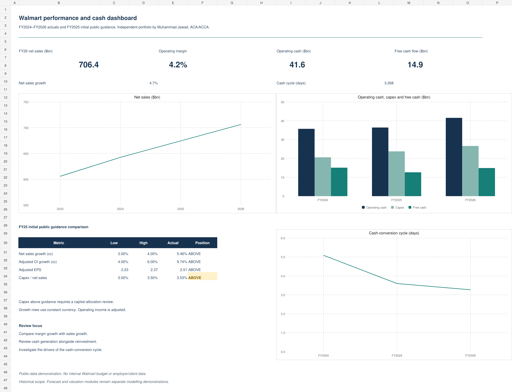

# Walmart FP&A Decision Dashboard

**Muhammad Jawad, ACA (ICAP), ACCA**

I built this independent public-data case to answer two finance questions: did Walmart exceed its initial public guidance, and how did growth translate into cash after capital expenditure?

[Download the Excel dashboard](generated/Walmart_FPA_Decision_Dashboard.xlsx?raw=true) · [Read the case study](CASE_STUDY.md) · [Inspect the sources](source_registry.yaml)



## What is delivered

The Excel workbook contains a performance dashboard, supporting calculations and source inputs. It has three editable charts and 124 formula cells. Python/Pandas produces the deterministic guidance and working-capital calculations. Configurable historical controls and assumptions are in `config/rules.yaml`.

The historical data covers FY2023–FY2026, with FY2023 opening balances supporting average working capital for FY2024. Fiscal years end January 31. Source tables use USD millions; dashboard cash and sales charts use USD billions.

## The comparison that required care

FY2025 initial sales guidance used constant currency. Operating-income guidance used an adjusted baseline. Comparing either with a different reported basis changes the measured variance.

| FY2025 metric | Initial guidance | Comparable actual | Interpretation |
|---|---:|---:|---|
| Net sales growth, constant currency | 3.0%–4.0% | 5.46% | Above range |
| Adjusted operating-income growth, constant currency | 4.0%–6.0% | 9.74% | Above range |
| Adjusted EPS, post-split | $2.23–$2.37 | $2.51 | Above range |
| Capital expenditure / reported net sales | Approximately 3.0%–3.5% | 3.53% | Review capital allocation |

Higher spending is not automatically a favourable result. The dashboard flags the capex comparison for review.

For FY2026, reported net sales were $706.413bn. Operating cash flow of $41.565bn less $26.642bn of payments for property and equipment produced $14.923bn of free cash flow. Derived cash-cycle days were 5.091 in FY2024, 3.598 in FY2025 and 3.268 in FY2026.

## Reproduce the calculations

```bash
python -m venv .venv
# Activate the environment using the command for your operating system.
python -m pip install -r requirements.txt
python run_acceptance.py
python scripts/prepare_dashboard.py
```

The acceptance runner uses Python's standard `unittest` engine. No API key, paid service or network retrieval is required for these commands. The inputs are a curated snapshot of official public disclosures. To refresh, verify the new source records and update the input files and source registry before running the calculations.

Open the delivered `.xlsx` in Excel to explore its formulas and charts. The optional workbook-authoring script uses the Codex artifact-tool runtime; that runtime is not required to use the exported workbook.

## Validation and governance

27 acceptance checks passed for this project. They cover working-capital results, guidance boundaries and comparable bases, missing/non-finite values, invalid denominators, duplicate or missing years, and the existing forecast checks. Workbook validation includes a formula-error scan, Python-to-workbook reconciliation, input-change recalculation and visual inspection of all three sheets. Exported chart bindings and colours were inspected.

`scripts/prepare_dashboard.py` creates a local SQLite deterministic-run record with SHA-256 hashes of inputs, rules and outputs. It also creates the exact 10-field LLM governance schema. No external model API is called, and no production LLM failure-handling test is claimed. Runtime ledgers are private and excluded from this repository.

## Scope and next phase

This is an independent portfolio demonstration using public financial facts and deterministic derivations. It contains no internal company budget, synthetic transactions, paid-course dataset, employer-confidential data or client records. It implies no employment by or endorsement from Walmart.

The included forecast and DCF code remains a separate modelling demonstration. Its existing tests do not establish complete accounting assurance. The v2 gate is a finance review of lease, minority-interest, financing and valuation treatment, with additional adverse-case checks before promotion. No Power BI `.pbix` is included.

The [source registry](source_registry.yaml) identifies the official SEC filings and earnings releases. Detailed calculations and source sections are explained in the [case study](CASE_STUDY.md).
